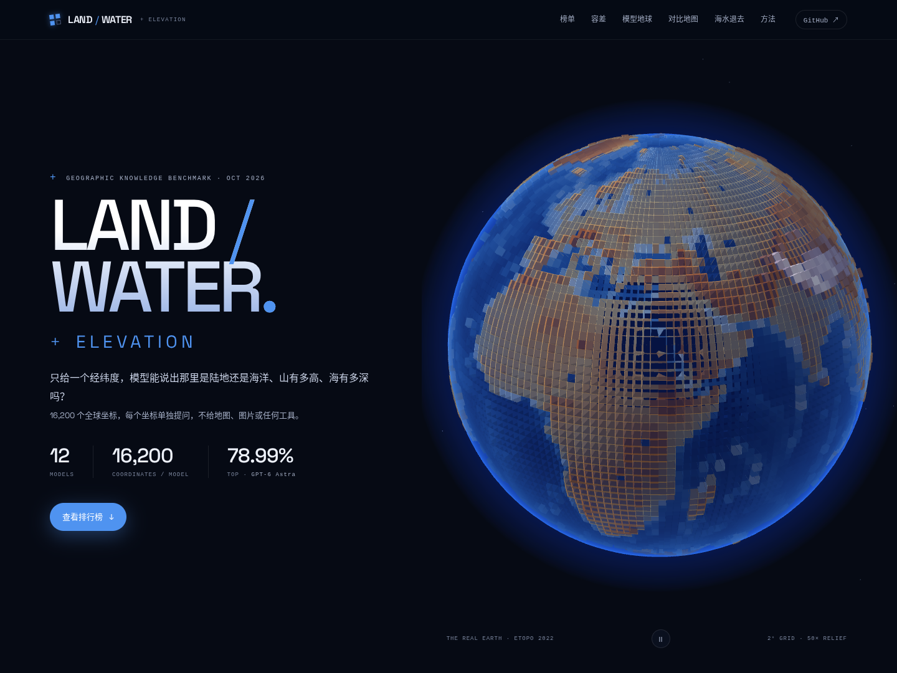

# Land / Water / Elevation Bench

One coordinate. Surface type and height. A model’s map of the world.

[](https://github.com/Warren-swr/land-water-bench/actions/workflows/checks.yml)
[](https://github.com/Warren-swr/land-water-bench/actions/workflows/pages.yml)
[](LICENSE)

[Interactive leaderboard](https://warren-swr.github.io/land-water-bench/) · [Latest results](results/2026-10-11/RESULTS.md) · [Terrain protocol](docs/TERRAIN-GLOBAL.md) · [中文说明](docs/README.zh-CN.md)

Predict Solid/Water and ground or seabed elevation from a single latitude and longitude. The main leaderboard requires both the correct surface type and elevation within ±500 m, weighted by latitude. A separate column reports accuracy from the independently run classification-only task.

Both tasks use the same **16,200-point global grid**. Each coordinate is an independent direct model API request, with no Agent runtime, tools, browsing, images, map context, reference answers, or conversation history.

Inspired by [Celeste’s experiment](https://x.com/celestepoasts/status/2103232383139057950). This is an independent reproduction and extension; scores are not directly comparable to the original post.



## Included in this clone

- **12 models × 2 tasks × 16,200 coordinates = 388,800 records**, including final answer text, predictions, invalid and unresolved states, settings, completion evidence, and frozen checksums.
- Frozen **GSHHG 2.3.7** classification and **ETOPO 2022 / EGM2008** elevation references. The terrain input includes all prompts, four native cell values per point, and the predeclared height mask.
- Direct API runners for Responses and Messages protocols, per-model concurrency, bounded retries, checkpointing, and resumable runs.
- One dark-themed results page: the leaderboard with model filters and CSV export; a tolerance study (joint accuracy from ±100 m to ±2,000 m in 100 m steps, with a live re-ranking); a three.js relief globe per model with a signed-error mode; a swipe map comparing any two models or the reference; a scroll-driven “draining the ocean” view of every depth band; and a coordinate inspector with both models’ raw answers. Joint classification + elevation at ±500 m remains the primary ranking; independent classification stays in its own column.
- Offline verification, static-site building, tests, and GitHub Pages deployment. No external workspace paths, private data mounts, or symlinks are required.

The latest snapshot is **2026-10-11**, after timeout recovery and answer-extraction corrections. It contains 471 invalid / 723 unresolved terrain records and 40 invalid / 2 unresolved classification records. Seed 0902 and 0915 are displayed as one model, as explicitly confirmed, while retaining each task’s original source identity.

## Clone and view

Python 3.11+ on Linux or macOS; Windows can use WSL.

```bash
git clone https://github.com/Warren-swr/land-water-bench.git
cd land-water-bench
python3 -m venv .venv
source .venv/bin/activate
python -m pip install -e .

lwb verify
lwb build
lwb serve --directory dist --port 8732
```

Open <http://localhost:8732>. The default commands verify and display **both latest tasks**. No API key or geographic-source download is required. `lwb build` requires a fresh output directory; for another build use `--output dist-next`.

To inspect a classification-only or historical snapshot:

```bash
lwb build --results results/2026-10-11/classification --output dist-classification
lwb verify --results results/2026-10-10
```

## Run your own model

Copy `configs/models.example.yaml` to the ignored `configs/local.yaml`. Set the endpoint URL, API-key environment variable, and model ID indicated in that configuration. Both wire protocols are supported; use names and reasoning settings available to your account. Environment files are not loaded automatically.

```bash
# Main task: a small smoke run using the bundled global reference.
lwb run-terrain --config configs/local.yaml --models responses-model \
  --run-dir runs/terrain-smoke --limit 8 --concurrency 2 --max-retries 3

# Main task: every coordinate; a new run directory is required.
lwb run-terrain --config configs/local.yaml --models responses-model \
  --run-dir runs/terrain-full --concurrency 512 --max-retries 1000

# Verify and display your completed full-grid terrain run.
lwb export-terrain-run --run-dir runs/terrain-full --output dist-my-terrain

# Independent classification-only task.
lwb run --config configs/local.yaml --models responses-model \
  --run-dir runs/classification-full --concurrency 512 --max-retries 1000
```

Concurrency is **per model**: two models at 512 may issue up to 1,024 simultaneous requests. The output cap defaults to 65,536 tokens; support depends on the endpoint. Terrain reads initially time out at 300 seconds, then 600 seconds, with two timeout retries by default. General rate-limit retries are bounded separately. The saved recovery batches used up to eight total timeout attempts.

Re-run the same command to resume an unsealed run. Attempt budgets are retained. `Ctrl+C`, `SIGTERM`, or `RUN_DIR/STOP_REQUESTED.json` stops scheduling. Completed wrong or invalid answers are not automatically resampled.

[Runner configuration and classification export](docs/RUNNING.md) · [Terrain running, collection export, and reference rebuilding](docs/TERRAIN-GLOBAL.md) · [Recovery](docs/RECOVERY.md) · [Versioned re-extraction](docs/REEXTRACTION.md)

## Scores and limits

The primary metric is area-weighted joint accuracy: type correct **and** absolute elevation error ≤500 m. Only 15,928 points have an accepted height reference; the other 272 retain their classification results. ±100 m and ±1,000 m scores, MAE, and terrain-task classification accuracy are available in model details.

- Invalid responses remain in the denominator and count as wrong. Actual format errors, empty answers and output truncation are still invalid.
- Unresolved API requests, including content filtering returned with HTTP 200, are excluded from numerator and denominator. Counts and coverage remain visible.
- Explanations, formula braces, identical repeated JSON and explicit final corrections are supported by the versioned parser. Thinking/reasoning blocks are not used as answers.
- Grounded ice is Solid with ice-surface height. Water includes oceans, lakes and floating ice shelves, with seabed/lakebed height rather than water-surface height.
- Static references have source and grid limitations. Small score gaps, unmatched reasoning budgets, and single samples do not establish stable model superiority.

Model names are gateway experiment aliases, not independently attested provider identities or promises of publicly available API names. The snapshot preserves different historical budgets and recorded recovery/replay policies. [Classification protocol and historical provenance](docs/PROTOCOL.md).

## Repository layout

```text
src/land_water_bench/       Runners, parsers, scoring, reference builders, CLI
  data/                    Frozen classification and full terrain inputs
results/2026-10-11/         Current terrain/ and classification/ result packages
results/2026-10-10/         Preserved historical classification release
web/unified/               Current unified page source
web/                       Classification page, fonts and license notices
configs/                   Environment-variable model configuration examples
scripts/                   Publication and browser checks
tests/                     Offline unit and mock-API integration checks
docs/                      Protocols, provenance and usage
.github/workflows/         Tests and GitHub Pages deployment
```

Private service connections, credentials, full provider envelopes and operational logs are not published. The bundled answer bodies, completion metadata and references are sufficient to verify every displayed score offline; they do not attest the original provider identity. Historical raw evidence remains archived by the experiment owner.

## Development and deployment

```bash
python -m pip install -e '.[dev,reference]'
python -m pytest -q
lwb verify
python -m build --outdir /tmp/land-water-packages
lwb build --output dist-check
python -m playwright install chromium
lwb serve --directory dist-check --port 8733
# In another terminal:
python scripts/check_unified_browser.py --url http://localhost:8733/ --output runs/browser-check
```

Tests use mock APIs. CI verifies the bundled references, extraction and scores, builds the unified site, and tests model switching, sorting, answers, the tolerance curves, the WebGL globes, the swipe map and mobile widths. GitHub Pages builds the same site from the repository and publishes only `dist/`; it never needs model credentials or local run archives. For a fork, enable **Settings → Pages → GitHub Actions** and update the repository links.

Original code: MIT. GSHHG-derived labels retain LGPL-3.0 notices, the font retains its OFL license, and upstream data and model responses retain applicable terms. [Third-party notices](THIRD_PARTY_NOTICES.md).
